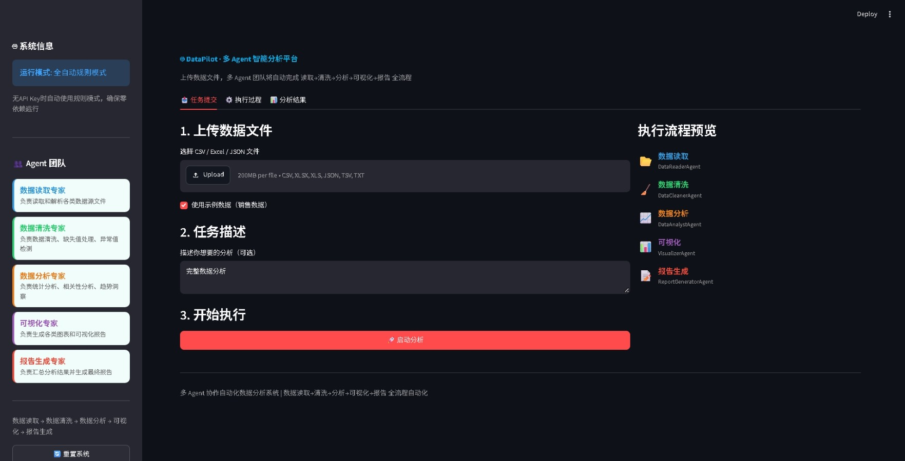
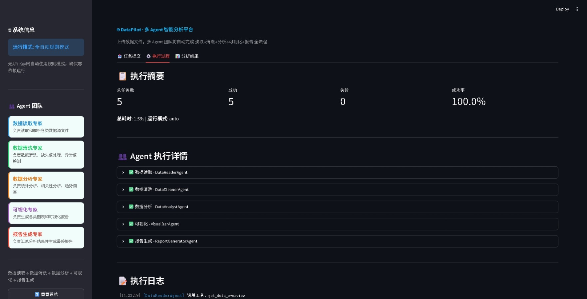
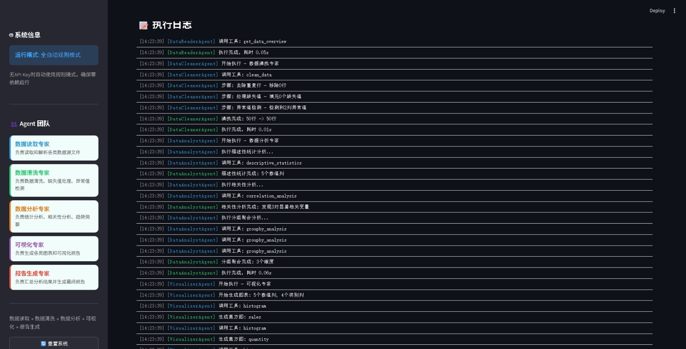
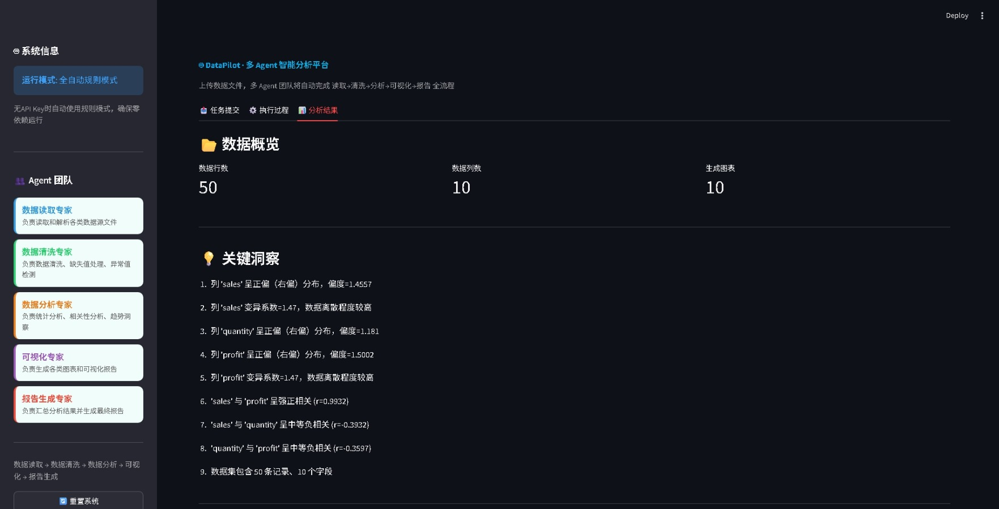
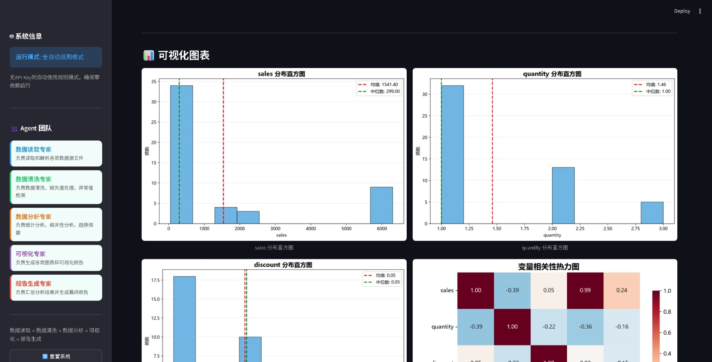
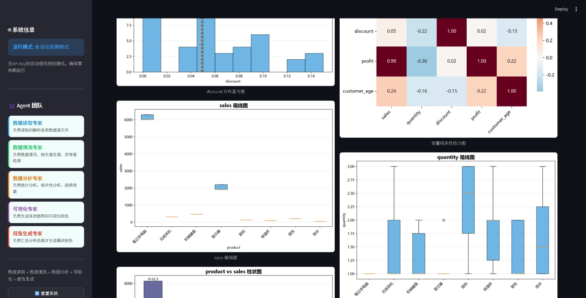
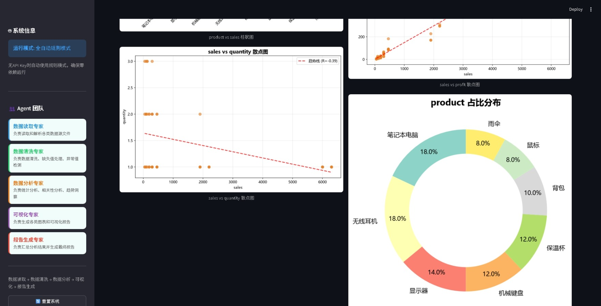
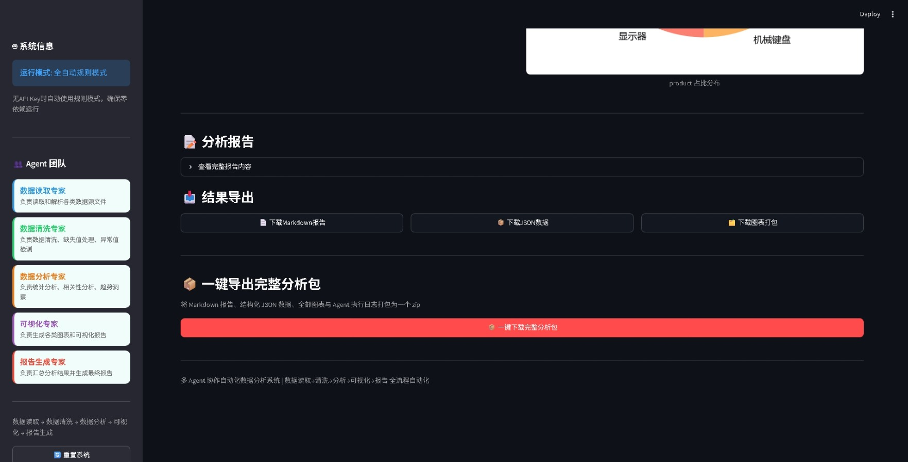
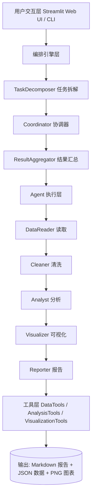

# 🤖 DataPilot · 多 Agent 智能分析平台


> 基于多 Agent 协作架构的端到端自动化数据分析平台：上传一个 CSV/Excel/JSON 文件，
> 5 个专业 Agent 自动完成「读取 → 清洗 → 分析 → 可视化 → 报告」全流程。
> **无需 API Key 也能跑**：零配置走规则模式，配置 Key 后自动切换 LLM 智能模式。

## ✨ 功能截图

### 📤 任务提交

上传文件或勾选内置示例数据，填写分析需求后一键启动，右侧实时展示 5 个 Agent 的执行流程。



### ⚙️ 执行过程

左：执行摘要（任务数 / 成功 / 失败 / 成功率、耗时）与各 Agent 执行详情；右：逐行执行日志，可回溯每个 Agent 的工具调用与产出。

 

### 📊 分析结果

数据概览与关键洞察（自动生成 9 条数据结论）：



自动生成的可视化图表（直方图、相关性热力图、箱线图、柱状图等，中文标题正常显示）：

 

散点图（含趋势线/相关系数）与产品占比环形图：



分析报告查看与结果导出，支持一键下载完整分析包（报告 + 数据 + 图表 + 执行日志）：



## 🚀 快速开始

**环境要求**：Python 3.10+（实测 3.13 可用）

```bash
# 1. 克隆并进入
git clone https://github.com/qie0403/mag-dt-ana.git
cd mag-dt-ana

# 2. 安装依赖（建议先建虚拟环境）
pip install -r requirements.txt

# 3. 可选：配置 LLM（不配置则使用全自动规则模式）
cp .env.example .env     # Windows: copy .env.example .env
```

启动 Web 界面（浏览器打开 http://localhost:8501）：

```bash
streamlit run main.py
```

> 若 8501 端口被占用，Streamlit 会自动切换到 8502 等端口，注意看终端提示；
> 也可手动指定端口：`streamlit run main.py --server.port 8610`

命令行直接分析示例数据：

```bash
python run.py samples/sample_sales_data.csv
```

Docker 一键启动：

```bash
docker compose up -d --build
```

## 🔀 双运行模式

| 模式 | 触发条件 | 能力 |
|---|---|---|
| 全自动规则模式（默认） | 未配置 OPENAI_API_KEY | 零依赖可运行，规则驱动完成全流程 |
| LLM 智能模式 | 配置了 OPENAI_API_KEY | 自然语言任务拆解，更灵活的智能分析 |

在 `.env` 中可配置：`OPENAI_API_KEY`、`OPENAI_BASE_URL`、`LLM_MODEL`（项目会自动读取 `.env`）。

## 🧩 核心特性

- **5 个专业 Agent 流水线协作**：数据读取 → 清洗 → 分析 → 可视化 → 报告，各司其职、可独立扩展。
- **自然语言任务自动拆解**：TaskDecomposer 自动识别所需 Agent 并编排执行顺序。
- **全流程可视化监控**：Streamlit 界面实时展示每个 Agent 的状态、耗时与执行日志。
- **一键导出完整分析包**：Markdown 报告 + 结构化 JSON + 全部图表 + 执行日志，一键打包成 zip。
- **自包含分析报告**：图表以 base64 内嵌进 Markdown，单文件即可转发查看。
- **7 类图表自动生成**：直方图、相关性热力图、箱线图、柱状图、散点图、饼图、缺失值热力图（数量随数据特征自动调整）。
- **双模式零门槛**：没有 API Key 也能完整体验，配置 Key 后自动升级为 LLM 模式。
- **易扩展**：新增 Agent 只需继承 BaseAgent 并实现 `_run()` 方法（见文末）。

## 🏗️ 系统架构



## 👥 Agent 设计

| Agent | 职责 | 核心工具 |
|---|---|---|
| DataReaderAgent | 智能读取 CSV/Excel/JSON/TSV/TXT（自动识别编码） | read_file, get_data_overview |
| DataCleanerAgent | 去重、缺失值填充、IQR/Z-Score 异常值检测 | clean_data |
| DataAnalystAgent | 描述性统计、相关性、分组聚合、时间趋势 | descriptive_statistics, correlation_analysis 等 |
| VisualizerAgent | 依数据特征自动生成 7 类图表 | histogram, boxplot, heatmap, scatter, bar, pie |
| ReportGeneratorAgent | 汇总生成 Markdown + JSON 报告（图表内嵌） | 内置模板引擎 |

## 📦 输出产物

运行一次后，`output/` 目录产出：

- `analysis_report_YYYYMMDD_HHMMSS.md`：完整分析报告（数据概览、清洗、统计、关键洞察、内嵌图表）
- `analysis_data_YYYYMMDD_HHMMSS.json`：结构化分析结果
- `*.png`：全部可视化图表
- Web 界面还可一键下载包含上述内容 + 执行日志的 `analysis_bundle.zip`

## 📁 项目结构

```
mag-dt-ana/
├── main.py                 # Streamlit Web 界面
├── run.py                  # 命令行入口
├── config.py               # 全局配置（自动加载 .env）
├── requirements.txt        # 依赖清单
├── Dockerfile              # Docker 镜像构建
├── docker-compose.yml      # Docker 一键编排
├── .env.example            # 环境变量模板
├── LICENSE                 # MIT 许可证
├── CHANGELOG.md            # 更新日志
├── agents/                 # Agent 层（5 个专业 Agent + 基类）
├── orchestrator/           # 编排引擎（任务拆解 + 协调器 + 结果汇总）
├── tools/                  # 工具层（数据 / 分析 / 可视化）
├── utils/                  # 工具函数（日志 + 辅助函数）
├── samples/                # 示例数据（销售数据）
├── assets/                 # README 功能截图
└── output/                 # 运行产物（已 gitignore）
```

## 🛠️ 扩展开发

新增一个 Agent：继承 `BaseAgent`，实现 `_run(context)` 方法，
再注册到 `Coordinator.AGENT_CLASSES` 即可接入流水线。

## ❓ 常见问题

- **图表中文显示为方块 / 出现字体告警**：Windows 自带「微软雅黑」可直接显示；
  Linux 下可安装中文字体（如 `fonts-wqy-microhei`），或在 `tools/visualization_tools.py`
  的 `font.sans-serif` 中调整字体列表。
- **没装 API Key 能跑吗**：能。未配置 `OPENAI_API_KEY` 时自动进入规则模式，全流程可用。
- **支持哪些文件格式**：CSV、TSV、TXT、Excel(xlsx/xls)、JSON；读取时自动尝试多种编码。
- **8501 端口被占用怎么办**：终端会提示实际端口，或用 `--server.port` 指定其他端口。

## 📝 更新记录

详见 [CHANGELOG.md](CHANGELOG.md)。

## 📄 License

[MIT](LICENSE)
